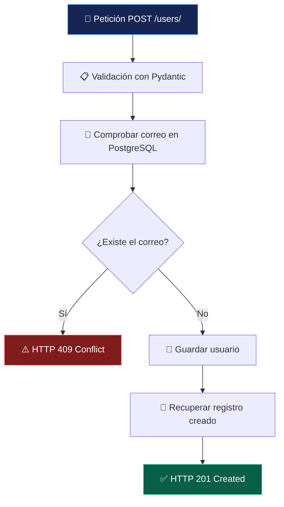
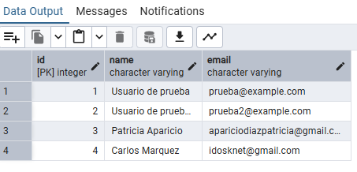

# 💜 API de Usuarios

<p align="center">
  
</p>

<p align="center">
  <strong>Del código a la base de datos, paso a paso.</strong>
  <br>
  Una API REST para crear usuarios, validar correos electrónicos y almacenar información en PostgreSQL.
</p>

<p align="center">
  
  
  
  
</p>

<p align="center">
  <em>✨ Aprender backend construyendo algo real.</em>
</p>

---

## 🪄 Sobre el proyecto

**API de Usuarios** es un proyecto individual de aprendizaje backend desarrollado con Python y FastAPI.

Su objetivo es construir una API capaz de recibir los datos de un usuario, comprobar si su correo electrónico ya existe y guardar el nuevo registro en una base de datos PostgreSQL.

Más allá de crear un endpoint, este proyecto permite practicar conceptos fundamentales del desarrollo backend: separación de responsabilidades, validación de datos, acceso a bases de datos y códigos de respuesta HTTP.

## ⚡ Funcionalidades

<table>
  <tr>
    <td width="50%">
      <h3>👤 Creación de usuarios</h3>
      Recibe el nombre y el correo electrónico y crea un registro con identificador propio.
    </td>
    <td width="50%">
      <h3>🛡️ Control de duplicados</h3>
      Comprueba si el correo ya está registrado y devuelve un error HTTP 409 si existe.
    </td>
  </tr>
  <tr>
    <td width="50%">
      <h3>🗄️ Persistencia de datos</h3>
      Guarda los registros en PostgreSQL mediante SQLAlchemy.
    </td>
    <td width="50%">
      <h3>📘 Documentación interactiva</h3>
      Permite explorar y probar el endpoint desde Swagger UI, integrado con FastAPI.
    </td>
  </tr>
</table>

## 🔄 ¿Cómo funciona?



## 🧰 Tecnologías

| Tecnología | Para qué se utiliza |
|---|---|
| Python | Lenguaje principal del proyecto |
| FastAPI | Creación del endpoint REST |
| SQLAlchemy | Comunicación con la base de datos mediante ORM |
| PostgreSQL | Almacenamiento persistente |
| Psycopg | Controlador de PostgreSQL |
| Pydantic | Validación de los datos de entrada y salida |
| python-dotenv | Lectura de variables de entorno |
| Uvicorn | Servidor de desarrollo ASGI |

## 🗂️ Arquitectura del proyecto

```text
api_usuarios/
├── app/
│   ├── api/
│   │   └── user_routes.py  # Endpoint para crear usuarios
│   ├── database.py         # Conexión y sesiones de BD
│   ├── main.py             # Aplicación FastAPI
│   ├── models.py           # Modelo User
│   └── schemas.py          # Esquemas de entrada y salida
├── assets/
│   └── banner-api-usuarios.png
├── .env                    # Configuración privada local
├── .gitignore              # Archivos excluidos de Git
├── README.md               # Documentación
└── requirements.txt        # Dependencias
```

### 🧩 Separación de responsabilidades

- **`main.py`**: crea la aplicación e incorpora el router.
- **`api/user_routes.py`**: define el endpoint y su lógica de creación.
- **`database.py`**: configura SQLAlchemy y las sesiones de base de datos.
- **`models.py`**: representa la tabla `users`.
- **`schemas.py`**: define los datos esperados y la respuesta de la API.

## 🚀 Instalación y puesta en marcha

### 1. Clonar el repositorio

```bash
git clone URL_DE_TU_REPOSITORIO
cd api-usuarios
```

Sustituye `URL_DE_TU_REPOSITORIO` por la URL real de tu repositorio.

### 2. Crear el entorno virtual

```bash
python -m venv .venv
```

En Git Bash para Windows:

```bash
source .venv/Scripts/activate
```

### 3. Instalar las dependencias

```bash
python -m pip install -r requirements.txt
```

### 4. Configurar PostgreSQL

Crea una base de datos llamada `api_usuarios` en PostgreSQL y prepara un archivo `.env` en la raíz del proyecto:

```dotenv
DB_HOST=localhost
DB_PORT=5432
DB_NAME=api_usuarios
DB_USER=postgres
DB_PASSWORD=TU_CONTRASEÑA
```

Sustituye `TU_CONTRASEÑA` por tu contraseña local.

> 🔐 **Seguridad:** no publiques el archivo `.env`, contraseñas ni otras credenciales. El repositorio debe contener únicamente la configuración de ejemplo, nunca tus secretos reales.

### 5. Arrancar el servidor

```bash
python -m uvicorn app.main:app --reload
```

Cuando el servidor esté funcionando, abre la documentación interactiva:

**[http://127.0.0.1:8000/docs](http://127.0.0.1:8000/docs)**

## 🔌 Endpoint disponible

| Método | Ruta | Función |
|---|---|---|
| `POST` | `/users/` | Crear un usuario |

### Ejemplo de petición

```json
{
  "name": "Usuario de prueba",
  "email": "prueba@example.com"
}
```

### Respuesta satisfactoria — `201 Created`

```json
{
  "id": 2,
  "name": "Usuario de prueba 2",
  "email": "prueba2@example.com"
}
```

*Ejemplo de respuesta obtenido durante las pruebas manuales.*

### Correo duplicado — `409 Conflict`

```json
{
  "detail": "Este correo electrónico ya está registrado"
}
```

## 🧪 Validaciones realizadas

Se han realizado comprobaciones manuales durante el desarrollo para verificar la carga de los componentes, la conexión a la base de datos y el funcionamiento del endpoint.

| Comprobación | Resultado observado |
|---|---|
| Importación de los esquemas | Correcta |
| Importación del router | Correcta |
| Carga de la aplicación FastAPI | Correcta |
| Arranque de Uvicorn | Correcto |
| Conexión con PostgreSQL | Correcta |
| Creación de un usuario desde Swagger | `201 Created` |
| Rechazo de un correo duplicado | `409 Conflict` |
| Verificación de los registros en pgAdmin | Correcta |

> **Comprobaciones manuales:** Estas comprobaciones preliminares permitieron verificar el comportamiento básico del servicio en el entorno local antes de implementar la suite de pruebas automatizadas.

<p align="center">
  
  <br>
  <em>Comprobación en pgAdmin de los usuarios creados y guardados en la base de datos.</em>
</p>

## 🧪 Pruebas automatizadas

El proyecto dispone de una suite de pruebas automatizadas diseñada para verificar el correcto funcionamiento de los endpoints, garantizar el cumplimiento de las reglas de negocio y prevenir regresiones.

### Herramientas y entorno de pruebas

- **`pytest`**: Framework principal para el descubrimiento, organización y ejecución de pruebas unitarias y de integración.
- **`pytest-bdd`**: Extensión para implementar pruebas guiadas por comportamiento (*Behavior-Driven Development*), vinculando especificaciones en lenguaje natural con código de prueba en Python.
- **Gherkin**: Lenguaje estructurado y legible tanto por perfiles técnicos como funcionales para describir escenarios mediante las palabras clave `Feature`, `Scenario`, `Given`, `When`, `Then` y `And`.
- **`FastAPI TestClient`**: Cliente de pruebas síncrono basado en `httpx` que permite simular peticiones HTTP hacia la aplicación FastAPI sin necesidad de arrancar el servidor Uvicorn.
- **Aislamiento con SQLite en memoria**: Las pruebas se ejecutan sobre una base de datos SQLite en memoria (`sqlite://`) utilizando un pool de conexión estático (`StaticPool`). Esto asegura una ejecución rápida, aislada y sin riesgo de modificar o requerir la base de datos PostgreSQL de desarrollo.

### Estructura de pruebas

```text
tests/
├── conftest.py
├── test_users.py
├── test_users_bdd.py
└── features/
    └── users.feature
```

- **`tests/conftest.py`**: Configuración global y fixtures de prueba. Inicializa el motor de base de datos SQLite en memoria y sobreescribe la dependencia `get_db` de FastAPI mediante `app.dependency_overrides`. Proporciona la fixture `client` con `TestClient(app)`, gestionando el ciclo de vida de creación (`Base.metadata.create_all`) y destrucción (`Base.metadata.drop_all`) de tablas para cada caso de prueba.
- **`tests/test_users.py`**: Pruebas de integración sobre los endpoints de usuarios utilizando `TestClient`. Comprueba la creación de usuarios con datos válidos (código HTTP 201 y payload devuelto) y el control de duplicados (código HTTP 409 y mensaje de conflicto).
- **`tests/test_users_bdd.py`**: Definiciones de pasos (*step definitions*) que conectan los pasos en lenguaje Gherkin con funciones de Python mediante los decoradores `@given`, `@when` y `@then` de `pytest-bdd`.
- **`tests/features/users.feature`**: Archivo de especificación en lenguaje natural Gherkin que describe el escenario funcional para la creación correcta de usuarios.

### Casos de prueba implementados

| Caso | Resultado esperado | Estado |
|---|---|---|
| Crear un usuario con datos válidos | HTTP 201 Created y datos del usuario | Implementado y validado |
| Crear un usuario con un correo duplicado | HTTP 409 Conflict | Implementado y validado |
| Escenario BDD de creación de usuario | Verificación del código HTTP y los datos devueltos | Implementado y validado |

### Ejecución de las pruebas

Para ejecutar la suite completa de pruebas desde la terminal:

```bash
./.venv/Scripts/python.exe -m pytest tests/ -v
```

O si el entorno virtual ya se encuentra activo en tu terminal:

```bash
pytest tests/ -v
```

#### Resultado de la última ejecución

La última ejecución de la suite confirmó **3 pruebas superadas**:

```text
tests/test_users.py::test_create_user_returns_201_and_user_data PASSED   [ 33%]
tests/test_users.py::test_create_user_with_duplicate_email_returns_409 PASSED [ 66%]
tests/test_users_bdd.py::test_crear_un_usuario_correctamente PASSED      [100%]

============================== 3 passed in 0.14s ==============================
```

> ⚠️ **Aclaración sobre la ejecución:** Este resultado corresponde a la última ejecución realizada en el entorno local y no garantiza automáticamente que futuras modificaciones en el código continúen superando las pruebas sin una nueva ejecución de verificación.

#### Interpretación del resultado

- **`PASSED`**: Indica que todas las aserciones (`assert`) del caso de prueba se evaluaron como verdaderas y no se produjeron excepciones inesperadas.
- **Porcentaje de avance (`[33%]`, `[66%]`, `[100%]`):** Refleja el progreso relativo conforme se ejecutan las pruebas recopiladas.
- **Resumen final (`3 passed in 0.14s`):** Confirma el total de pruebas satisfactorias y el tiempo invertido. Si alguna prueba fallara, `pytest` mostraría `FAILED` con la traza de la discrepancia entre el resultado esperado y el obtenido.

### Especificación BDD con Gherkin

El archivo `tests/features/users.feature` define el comportamiento esperado del sistema en lenguaje natural:

```gherkin
Feature: Gestión de usuarios

  Scenario: Crear un usuario correctamente
    Given que la API está disponible
    When envío los datos de un usuario nuevo
    Then la respuesta debe tener código 201
    And la respuesta debe incluir su nombre, correo e identificador
```

- **`Given que la API está disponible`**: Prepara el cliente de pruebas conectado a la aplicación.
- **`When envío los datos de un usuario nuevo`**: Envía una petición `POST /users/` con un nombre y un correo electrónico no registrado.
- **`Then la respuesta debe tener código 201`**: Confirma que el servidor responda con el código HTTP `201 Created`.
- **`And la respuesta debe incluir su nombre, correo e identificador`**: Valida que el cuerpo JSON de respuesta incluya el nombre, el correo y el identificador entero generado.

Este escenario se conecta con las funciones Python de `tests/test_users_bdd.py` mediante `pytest-bdd` y se ejecuta de manera integrada con el resto de las pruebas.

> **Alcance de la cobertura BDD:** La especificación BDD actual cubre exclusivamente el escenario de creación de usuario. No se asume cobertura BDD para operaciones que todavía no han sido implementadas.

## 🔐 Buenas prácticas

- Las credenciales se configuran mediante variables de entorno.
- El archivo `.env` debe permanecer fuera del repositorio.
- Las dependencias están declaradas en `requirements.txt`.
- La creación de usuarios comprueba la existencia previa del correo.
- La tabla `users` aplica una restricción de unicidad al correo electrónico.
- Aislamiento en pruebas: la suite automatizada opera sobre SQLite en memoria para no modificar ni requerir acceso a la base de datos PostgreSQL de la aplicación.

## 🛣️ Estado del proyecto y próximas mejoras

El proyecto se desarrolla bajo un enfoque incremental, distinguiendo claramente la funcionalidad actualmente implementada y validada de las mejoras planificadas.

### Funcionalidad implementada

- **Endpoint `POST /users/`:** Creación y registro de nuevos usuarios.
- **Control de unicidad:** Validación previa para impedir la duplicación de correos electrónicos.
- **Códigos de respuesta HTTP semánticos:**
  - `201 Created` cuando la creación es correcta.
  - `409 Conflict` cuando el correo ya está registrado en el sistema.
- **Esquemas de datos Pydantic:** Validación estricta en la entrada (`UserCreate`) y serialización de salida (`UserResponse`).
- **Persistencia relacional:** Integración mediante el ORM SQLAlchemy sobre base de datos PostgreSQL.
- **Pruebas automatizadas y BDD:** Suite con pruebas unitarias, de integración y escenario Gherkin para la creación de usuarios.

### Próximas mejoras previstas (Hoja de ruta)

Completar progresivamente las operaciones CRUD sobre la entidad de usuarios:

1. **Read — Listar usuarios:** `GET /users/` para consultar y paginar la lista completa de usuarios.
2. **Read — Consultar un usuario por ID:** `GET /users/{id}` para obtener el detalle de un usuario específico, gestionando el código `404 Not Found` en caso de no existir.
3. **Update — Actualizar un usuario existente:** `PUT /users/{id}` para modificar los datos de un usuario preservando las validaciones de unicidad.
4. **Delete — Eliminar un usuario:** `DELETE /users/{id}` para dar de baja o eliminar un registro del sistema.

> 📌 **Aclaración sobre la hoja de ruta:** Las operaciones CRUD listadas anteriormente corresponden a **mejoras futuras y no deben presentarse como implementadas**. Cada una de ellas se desarrollará de forma incremental con sus correspondientes validaciones, pruebas automatizadas y escenarios Gherkin cuando proceda, manteniendo la funcionalidad existente y evitando regresiones.

## 👩‍💻 Autora

Proyecto individual de aprendizaje y práctica de desarrollo backend.

**Objetivo:** aprender haciendo, validar cada paso y comprender lo que hay detrás del código.

<p align="center">
  <strong>💜 Código + Aprendizaje = Progreso</strong>
</p>

<p align="center">
  <sub>Built with Python · FastAPI · PostgreSQL</sub>
</p>