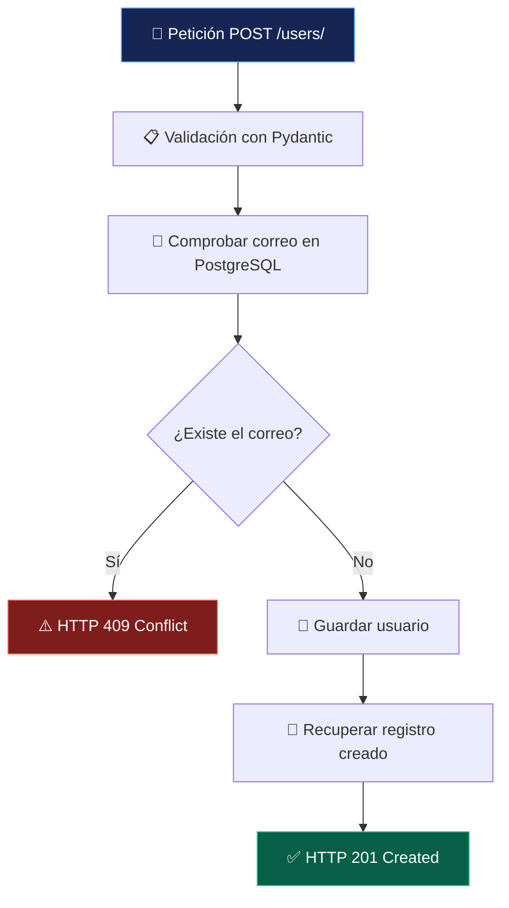

# 💜 API de Usuarios

<p align="center">
  
</p>

<p align="center">
  <strong>Del código a la base de datos, paso a paso.</strong>
  <br>
  Una API REST para crear usuarios, validar correos electrónicos y almacenar información en PostgreSQL.
</p>

<p align="center">
  
  
  
  
</p>

<p align="center">
  <em>✨ Aprender backend construyendo algo real.</em>
</p>

---

## 🪄 Sobre el proyecto

**API de Usuarios** es un proyecto individual de aprendizaje backend desarrollado con Python y FastAPI.

Su objetivo es construir una API capaz de recibir los datos de un usuario, comprobar si su correo electrónico ya existe y guardar el nuevo registro en una base de datos PostgreSQL.

Más allá de crear un endpoint, este proyecto permite practicar conceptos fundamentales del desarrollo backend: separación de responsabilidades, validación de datos, acceso a bases de datos y códigos de respuesta HTTP.

## ⚡ Funcionalidades

<table>
  <tr>
    <td width="50%">
      <h3>👤 Creación de usuarios</h3>
      Recibe el nombre y el correo electrónico y crea un registro con identificador propio.
    </td>
    <td width="50%">
      <h3>🛡️ Control de duplicados</h3>
      Comprueba si el correo ya está registrado y devuelve un error HTTP 409 si existe.
    </td>
  </tr>
  <tr>
    <td width="50%">
      <h3>🗄️ Persistencia de datos</h3>
      Guarda los registros en PostgreSQL mediante SQLAlchemy.
    </td>
    <td width="50%">
      <h3>📘 Documentación interactiva</h3>
      Permite explorar y probar el endpoint desde Swagger UI, integrado con FastAPI.
    </td>
  </tr>
</table>

## 🔄 ¿Cómo funciona?



## 🧰 Tecnologías

| Tecnología | Para qué se utiliza |
|---|---|
| Python | Lenguaje principal del proyecto |
| FastAPI | Creación del endpoint REST |
| SQLAlchemy | Comunicación con la base de datos mediante ORM |
| PostgreSQL | Almacenamiento persistente |
| Psycopg | Controlador de PostgreSQL |
| Pydantic | Validación de los datos de entrada y salida |
| python-dotenv | Lectura de variables de entorno |
| Uvicorn | Servidor de desarrollo ASGI |

## 🗂️ Arquitectura del proyecto

```text
api_usuarios/
├── app/
│   ├── api/
│   │   └── user_routes.py  # Endpoint para crear usuarios
│   ├── database.py         # Conexión y sesiones de BD
│   ├── main.py             # Aplicación FastAPI
│   ├── models.py           # Modelo User
│   └── schemas.py          # Esquemas de entrada y salida
├── .env                    # Configuración privada local
├── .gitignore              # Archivos excluidos de Git
├── README.md               # Documentación
└── requirements.txt        # Dependencias
```

### 🧩 Separación de responsabilidades

- **`main.py`**: crea la aplicación e incorpora el router.
- **`api/user_routes.py`**: define el endpoint y su lógica de creación.
- **`database.py`**: configura SQLAlchemy y las sesiones de base de datos.
- **`models.py`**: representa la tabla `users`.
- **`schemas.py`**: define los datos esperados y la respuesta de la API.

## 🚀 Instalación y puesta en marcha

### 1. Clonar el repositorio

```bash
git clone URL_DE_TU_REPOSITORIO
cd api-usuarios
```

Sustituye `URL_DE_TU_REPOSITORIO` por la URL real de tu repositorio.

### 2. Crear el entorno virtual

```bash
python -m venv .venv
```

En Git Bash para Windows:

```bash
source .venv/Scripts/activate
```

### 3. Instalar las dependencias

```bash
python -m pip install -r requirements.txt
```

### 4. Configurar PostgreSQL

Crea una base de datos llamada `api_usuarios` en PostgreSQL y prepara un archivo `.env` en la raíz del proyecto:

```dotenv
DB_HOST=localhost
DB_PORT=5432
DB_NAME=api_usuarios
DB_USER=postgres
DB_PASSWORD=TU_CONTRASEÑA
```

Sustituye `TU_CONTRASEÑA` por tu contraseña local.

> 🔐 **Seguridad:** no publiques el archivo `.env`, contraseñas ni otras credenciales. El repositorio debe contener únicamente la configuración de ejemplo, nunca tus secretos reales.

### 5. Arrancar el servidor

```bash
python -m uvicorn app.main:app --reload
```

Cuando el servidor esté funcionando, abre la documentación interactiva:

**[http://127.0.0.1:8000/docs](http://127.0.0.1:8000/docs)**

## 🔌 Endpoint disponible

| Método | Ruta | Función |
|---|---|---|
| `POST` | `/users/` | Crear un usuario |

### Ejemplo de petición

```json
{
  "name": "Usuario de prueba",
  "email": "prueba@example.com"
}
```

### Respuesta satisfactoria — `201 Created`

```json
{
  "id": 2,
  "name": "Usuario de prueba 2",
  "email": "prueba2@example.com"
}
```

*Ejemplo de respuesta obtenido durante las pruebas manuales.*

### Correo duplicado — `409 Conflict`

```json
{
  "detail": "Este correo electrónico ya está registrado"
}
```

## 🧪 Validaciones realizadas

Se han realizado comprobaciones manuales durante el desarrollo para verificar la carga de los componentes, la conexión a la base de datos y el funcionamiento del endpoint.

| Comprobación | Resultado observado |
|---|---|
| Importación de los esquemas | Correcta |
| Importación del router | Correcta |
| Carga de la aplicación FastAPI | Correcta |
| Arranque de Uvicorn | Correcto |
| Conexión con PostgreSQL | Correcta |
| Creación de un usuario desde Swagger | `201 Created` |
| Rechazo de un correo duplicado | `409 Conflict` |
| Verificación de los registros en pgAdmin | Correcta |

> **Estado de los tests:** estas son pruebas manuales y comprobaciones de funcionamiento. Todavía no se ha implementado ni ejecutado una suite de tests automatizados con `pytest`.

## 🔐 Buenas prácticas

- Las credenciales se configuran mediante variables de entorno.
- El archivo `.env` debe permanecer fuera del repositorio.
- Las dependencias están declaradas en `requirements.txt`.
- La creación de usuarios comprueba la existencia previa del correo.
- La tabla `users` aplica una restricción de unicidad al correo electrónico.

## 🛣️ Estado actual y próximos pasos

La funcionalidad principal de creación de usuarios está implementada y se ha comprobado manualmente.

Posibles mejoras futuras, sin formar parte de la funcionalidad actual:

- Añadir tests automatizados con `pytest` y `TestClient`.
- Probar datos inválidos y casos límite.
- Mejorar la gestión de errores de base de datos.
- Incorporar migraciones de esquema con Alembic si el proyecto crece.

## 👩‍💻 Autora

Proyecto individual de aprendizaje y práctica de desarrollo backend.

**Objetivo:** aprender haciendo, validar cada paso y comprender lo que hay detrás del código.

<p align="center">
  <strong>💜 Código + Aprendizaje = Progreso</strong>
</p>

<p align="center">
  <sub>Built with Python · FastAPI · PostgreSQL</sub>
</p>